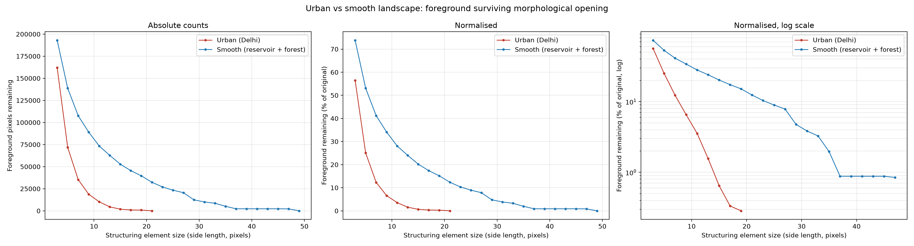
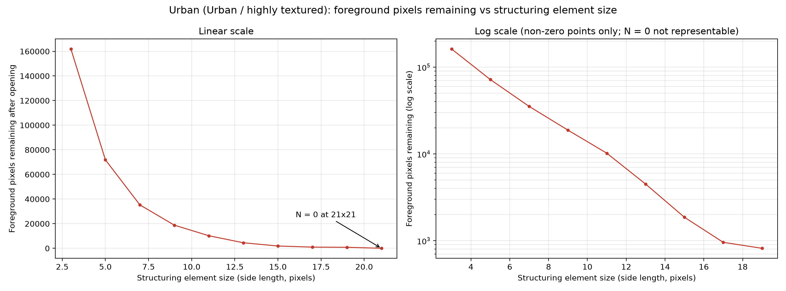
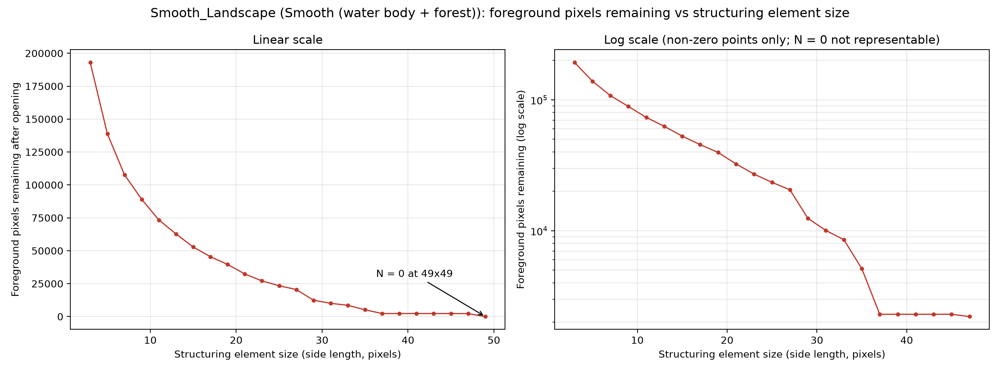

# Morphological Opening with Progressively Dilated Structuring Elements on Satellite Imagery

[](https://colab.research.google.com/github/PiyushTailor1905/gnr607-morphological-opening/blob/main/08_Colab/GNR607_Demo.ipynb)


A reproducible digital-image-processing experiment (course programming assignment, **GNR 607**) that measures how quickly the foreground of a binarised satellite image disappears under morphological opening with growing structuring elements — for an **urban / textured** scene and a **smooth water-and-forest** scene.

> **Task.** Binarise a remotely sensed image. Open it with a 3×3 box structuring element (SE) and count the surviving foreground pixels. Build a bigger SE by dilating the current SE with the 3×3 box (3×3 → 5×5 → 7×7 → …) and repeat, until the opening gives a null image. Plot SE size vs. surviving foreground pixels, for an urban image and for a smoother one.



## Key results

| | Urban (central Delhi) | Smooth (Ramganga reservoir + forest) |
|---|---|---|
| Otsu threshold *T* (foreground = gray > *T*) | 70 | 61 |
| Foreground pixels | 286,813 (27.35 %) | 261,466 (24.94 %) |
| Remaining after 3×3 opening | 161,943 (56.46 %) | 193,039 (73.83 %) |
| SE size where ≤ 10 % remains | 9×9 | 25×25 |
| **First null image** | **21×21** (10 iterations) | **49×49** (24 iterations) |

* **Observation:** the urban foreground disappears faster and reaches the null image first.
* **Interpretation (not measured directly):** the urban foreground is made of smaller objects; the smooth scene keeps larger patches.
* The smooth curve has a plateau (2,299 px for SE 37–45): a single 47×49 px rectangle survives until the SE no longer fits.
* **Supplementary run (foreground = dark pixels, so the water body is foreground):** null images at 109×109 (urban) and 289×289 (smooth).

| Urban | Smooth |
|---|---|
|  |  |

## How it works

1. **Binary image.** RGB → gray (`Y = 0.299R + 0.587G + 0.114B`) → global **Otsu** threshold → foreground (1) / background (0). Same rule for both images.
2. **Structuring elements.** `SE₀` = 3×3 box. `SE(k+1) = SE(k) ⊕ SE₀` (Minkowski sum, computed from its definition in `morphology.dilate_se`) → side lengths 3, 5, 7, 9, …
3. **Opening.** `A ○ B = (A ⊖ B) ⊕ B` with the same SE for both steps, always applied to the **original** binary image `A` (not cumulatively). Pixels outside the image count as background.
4. **Count & stop.** Count the non-zero pixels; stop at the first SE whose opening is empty (that zero is recorded). A safeguard raises an error instead of falsely reporting a null image.
5. **Outputs.** Per-iteration table (CSV + Excel), every opened image, graphs, comparison, per-experiment README with all parameters.

Why the count can never increase: opening is the union of all translates of *B* that fit inside *A*; every larger SE here is a union of translates of the smaller one, so `A ○ SE(k+1) ⊆ A ○ SE(k)`.

## Repository layout

```
02_Source_Code/   image_loader.py  preprocessing.py  morphology.py  experiment.py
                  visualization.py reporting.py  config.py  main.py
                  validate.py  sensitivity.py  fetch_data.py  requirements.txt
04_Sample_Data/   two Sentinel-2 crops (PNG) + metadata JSON
05_Results/       Urban/  Smooth_Landscape/  Comparative_Analysis/  Supplementary/
06_Documentation/ Methodology.md  Installation_Guide.md  Execution_Guide.md
07_Validation/    validation_report.txt  execution_log.txt
08_Colab/         GNR607_Demo.ipynb  (step-by-step notebook)
```

| Module | Role |
|---|---|
| `image_loader.py` | read images / metadata with clear errors |
| `preprocessing.py` | grayscale conversion, Otsu binarisation |
| `morphology.py` | SE generation by dilation, erosion, dilation, opening, counting |
| `experiment.py` | the loop: open original → count → record → stop at null |
| `visualization.py`, `reporting.py` | figures; CSV/XLSX tables and READMEs |
| `main.py` | command-line entry point |
| `validate.py` | independent verification (see below) |
| `sensitivity.py` | threshold / border-rule sensitivity and survivor analysis |

## Quick start

```bash
git clone https://github.com/PiyushTailor1905/gnr607-morphological-opening.git
cd gnr607-morphological-opening/02_Source_Code
pip install -r requirements.txt
python main.py               # runs both experiments + supplementary runs (~10 s)
python validate.py           # independent validation (run main.py first)
python sensitivity.py        # sensitivity analysis
```

Options: `python main.py --urban my_city.png --smooth my_lake.png --out my_results [--no-supplementary] [--selected-only]`.
Or run it step by step in the browser with the **Open in Colab** badge above (the notebook clones this repo; no installation needed).

> The committed `05_Results/` omits the per-iteration `opened_images/` folders to keep the repository small; `python main.py` regenerates them.

## Verification

`validate.py` runs 70 checks (all pass; see `07_Validation/validation_report.txt`):
* SE sequence equals repeated dilation by the 3×3 box (cross-checked with `cv2.dilate`, 160 elements);
* opening matches SciPy, a brute-force implementation of the set definitions, and an independent **summed-area-table** algorithm for **all 232 openings** of the four full-image experiments, plus random images with border-touching objects;
* Otsu threshold equals an independent NumPy implementation; saved binary images equal the thresholded originals;
* counts re-computed from the saved PNGs; counts are non-increasing; last count is exactly 0; re-running reproduces `results.csv` byte-for-byte.

## Sensitivity and limitations

Measured in `05_Results/Supplementary/Sensitivity/`: shifting Otsu's threshold by ±10 or using OpenCV's neutral border changes the exact null size (urban 19–23, smooth 35–55), but the urban curve stays below the smooth curve at every common SE size in all four matched variants. The ordering is robust; the exact sizes are not.

* One scene per class; scenes come from different dates (Dec 2025 / Apr 2026).
* With *foreground = bright*, the smooth scene's foreground is the brighter minority (fields, bare/sunlit slopes), **not** the water or forest; the dark-foreground run covers that reading.
* Sentinel-2 band values are used as stored (reflectance × 10⁴-like) with one fixed linear display stretch, DN/3000 × 255.
* Tested on Python 3.14 / Windows 11 only.

## Data and attribution

Sentinel-2 L2A scenes (`S2C_43RGM_20251224_0_L2A`, `S2C_44RKT_20260420_0_L2A`), true-colour (B04/B03/B02), 10 m, 1024 × 1024 px crops, obtained from the public AWS archive through the Element84 Earth Search STAC API (`02_Source_Code/fetch_data.py`; metadata in `04_Sample_Data/*/*_metadata.json`). Contains modified Copernicus Sentinel data (ESA).

## Tech stack

Python · NumPy · OpenCV · pandas / openpyxl · Matplotlib · SciPy (validation only) · rasterio (data download only)

## References

* R. C. Gonzalez, R. E. Woods, *Digital Image Processing* — morphological image processing.
* J. Serra, *Image Analysis and Mathematical Morphology*, Academic Press, 1982.
* N. Otsu, "A threshold selection method from gray-level histograms", *IEEE Trans. SMC* 9(1), 1979.
